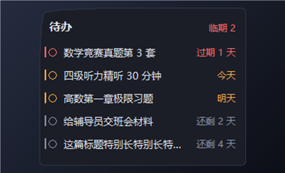
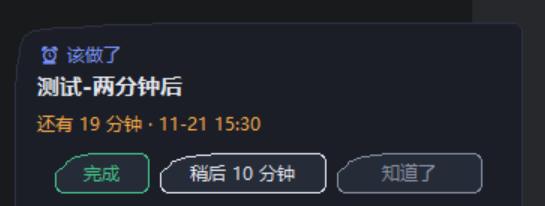
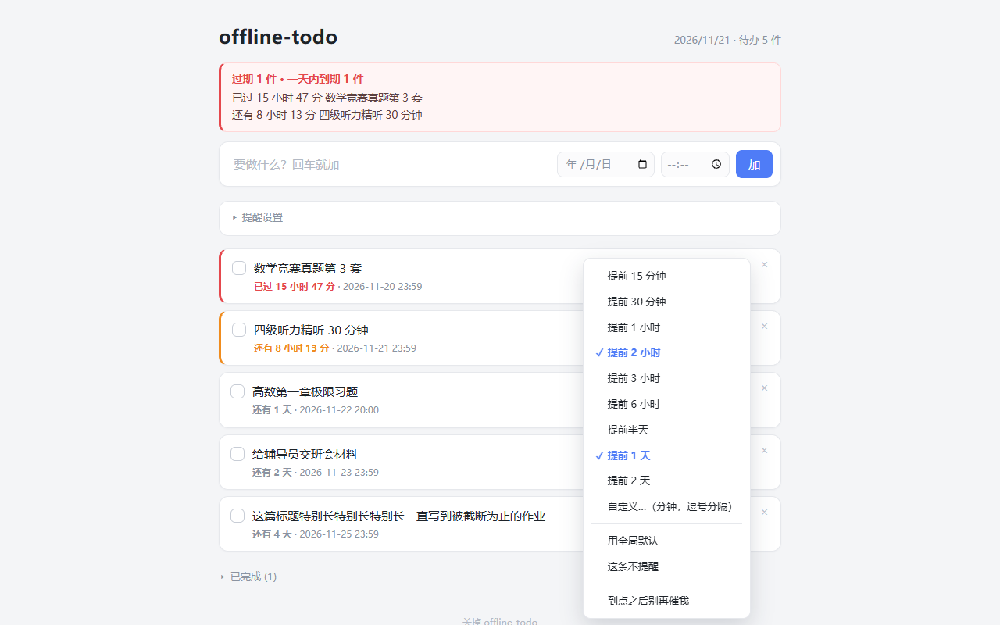

# offline-todo

> 一个只在你电脑上跑的待办清单。没有账号，不联网，数据就是硬盘上一个 JSON 文件。
> A local-only todo list. No account, no cloud, no telemetry — just a JSON file on your disk.


## 为什么又写一个待办

因为现成的那些，要么要注册、要么要开会员、要么在我没网的时候打不开。
这个只有一件事要做到：**我随手记下的事情，不会忘。**

所以它刻意做得小：

- **零依赖。** 只用 Python 标准库，`pip install` 一行都不用跑，也没有供应链风险。
- **零联网。** 服务只监听 `127.0.0.1`，除你之外的任何设备都连不进来。
- **零数据库。** 数据是 `data/todos.json`，纯文本，能看、能改、能复制走。
- **会过期就变红。** 过期标红、两天内标橙，顶部还有提醒条——先看最急的那几件。
- **抬眼就能看见。** 桌面卡片一直浮在屏幕上，不用打开任何东西，点一下就打勾。
- **到点会催。** 提前多久你自己定（默认 2 小时），弹出来的是右下角一张小卡片，能直接点「完成」。

## 快速开始

需要一个 Python 3.8 以上版本（[官网下载](https://www.python.org/downloads/)，Windows 安装时记得勾 *Add python.exe to PATH*）。

**Windows**

双击 `start.bat`

**macOS / Linux**

```bash
chmod +x start.sh
./start.sh
```

**或者随手一行**

```bash
python app.py               # 默认从 8765 端口开始找空位
python app.py --port 9000   # 指定端口
python app.py --no-browser  # 不自动开浏览器
```

启动后浏览器会自动打到界面。终端窗口就是程序本体，关掉它就退出；页面底部也有「关掉」。

## 桌面卡片

不想每次开浏览器？把临期的事直接贴在桌面上：



**Windows**：双击 `start-widget.bat`（用 `pythonw` 启动，不留黑框）
**macOS / Linux**：`python3 widget.py`（或 `./start-widget.sh`）

| 操作 | 怎么做 |
|---|---|
| 加一条 | 点卡片最下面那行「＋ 要做什么」，打字，回车 |
| 完成一条 | 左键点那一行（再点一次撤销） |
| 改内容／改日期 | 双击那一行的标题 |
| 删掉一条 | 右键那一行 → 删除这条（删错了 6 秒内点提示就能撤回） |
| 单独设提前量 | 右键 → 修改这条，把时间也一起改掉；或者在网页版点 🔔 |
| 挪位置 | 按住卡片拖，位置会记住 |
| 打开完整界面 | 右键 → 打开完整界面（网页版没开的话会自动拉起来） |
| 不挡窗口 | 右键 → 不挡窗口（取消勾选就重新置顶） |
| 关掉卡片 | 右键 → 关闭卡片，或按 `Esc` |

### 卡片上顺手写日期

在卡片上加东西时，日期可以直接写进句子里，**写在最后**就行，不用去点日期框：

| 你打的字 | 它理解成 |
|---|---|
| `交作业 明天` | 标题「交作业」，明天 23:59 |
| `交作业 明天 18:00` | 明天 18:00 |
| `实验报告 周五` | 这周还没到就是这周，过了就是下周 |
| `答辩 下周二 9:30` | 下周二 9:30 |
| `复盘 11-25` | 11 月 25 日 23:59（`11/25`、`11月25日` 也认） |
| `复习 今晚 8 点` | 今晚 20:00 |
| `取快递 后天` | 后天 23:59 |
| `打印材料` | 没有截止日，沉在列表最下面 |

时间也能写成 `18:00`、`18点`、`18点30`、`18点半`；`14:00` 已经过了的话，只写时间会顺延到明天。

它和网页版**共用同一份 `data/todos.json`**：

- 卡片上点一下 → 那条立刻变完成，网页版下次请求就能看到
- 网页版里改了 → 卡片 2 秒内自己刷新
- 只显示临期（今天/明天）的，最多 6 条；没有临期的就用最近的几条补满

圆角和半透明靠 Windows 的色键透明实现，所以 mac/Linux 上会显示成直角方块——功能一样，只是没那么好看。`TODO_WIDGET_OPAQUE=1 python widget.py` 可以关掉透明（比如在某些远程桌面里发虚的时候）。

### 开机自启

不想每次手动点它：

```bash
python autostart.py --install    # 装：下次登录桌面卡片自己出现
python autostart.py --status     # 看现在装了没、装在哪个文件
python autostart.py --uninstall  # 撤掉，不留痕迹
```

装的就是一个几行的启动脚本，放在系统的「登录时自动运行」目录里：

- Windows：`%APPDATA%\Microsoft\Windows\Start Menu\Programs\Startup\offline-todo-widget.cmd`
- Linux：`~/.config/autostart/offline-todo-widget.desktop`
- macOS：没做

想手动撤销也行，去上面那个目录把 `offline-todo-widget` 删了即可。

## 到点提醒

卡片开着的时候，它自己会盯着时间。**离截止还有多久，你自己定。**



到点弹出来的是一张小卡片，浮在右下角，三个按钮：

| 按钮 | 效果 |
|---|---|
| 完成 | 这条直接打勾，网页版同步看到 |
| 稍后 10 分钟 | 先闭嘴，十分钟后再来一次 |
| 知道了 | 这次先放过它（到下一个周期还会催） |

**提前多久**，两个地方可以定：

- **全局默认**：网页版「提醒设置」里选，比如「提前 2 小时」——没单独设过的条目都用这个
- **单条覆盖**：每条右边有个 🔔，点开是**勾选框**，可以勾好几个

单条那栏可以勾一组，比如同时勾「提前 1 天」和「提前 2 小时」——

- 到「还有 1 天」时弹一次，到「还有 2 小时」时再弹一次，**每个点各弹一次**
- 都弹完了、事还没做完 → 接着按「没做完隔多久再催」的节奏催（默认 30 分钟一次，最多 3 次）
- 不想被接着催：在同一个菜单里勾上「到点之后别再催我」
- 最多 5 个提前量；「自定义…」里能填任意分钟数（比如 `90,1440`）



还有两个旋钮在同一个面板里：

- **没做完隔多久再催**（默认 30 分钟）
- **同一条最多催几次**（默认 3 次，催完就不烦你了）

几个细节，省得你猜：

- 填了具体时间就按那个时间算；只填日期，按**当天 23:59** 算
- 过期了还会催，但**过期超过 3 天**就自动闭嘴（不然旧账天天弹）
- 提醒只由桌面卡片发；网页版开着而卡片没开时，启动那一刻会用系统对话框兜底提一次
- 改截止时间 / 改成完成，已经弹过的点会清零——新时间从头算一遍

## 怎么用

| 操作 | 怎么做 |
|---|---|
| 加一条 | 输入框里打字，回车 |
| 定截止日 | 用右边的日期框；后面那个时间框可以空着（空着按 23:59） |
| 做完了 | 点左边的小方框，再点一次撤销 |
| 改内容/改日期 | **双击标题** |
| 单独设提醒 | 点右边的 🔔 |
| 删掉 | 点右边的 × |

排序规则很简单：有截止日的按时间从近到远，没时间的沉底。

## 数据在哪

```
data/todos.json
```

- **备份** = 把这个文件复制走
- **换电脑** = 把这个文件拷过去
- **清空** = 删掉它（下次启动会重新建）
- `data/` 已经在 `.gitignore` 里，你的待办不会被 git 带上提交

## 目录结构

```
offline-todo/
├── app.py              # 后端：读写 JSON、HTTP 接口
├── ui.html             # 前端：整个界面就这一个文件，没有构建步骤
├── remind.py           # 提醒规则：解析时间、算该弹哪几条（两边共用）
├── widget.py           # 桌面卡片：浮在屏幕上，和网页版共用一份数据
├── autostart.py        # 开机自启的安装/卸载/查看
├── start.bat           # Windows 双击入口（网页版）
├── start-widget.bat    # Windows 双击入口（桌面卡片，不留黑框）
├── start.sh            # macOS / Linux 入口（网页版）
├── start-widget.sh     # macOS / Linux 入口（桌面卡片）
├── screenshots/
│   ├── main.png
│   ├── widget.png
│   ├── reminder.png
│   └── remind-menu.png
├── data/todos.json     # 你的数据（不提交）
├── data/settings.json  # 提醒设置（不提交）
├── LICENSE
└── README.md
```

核心就三个：`app.py` 管数据，`ui.html` 管界面，`remind.py` 管什么时候该提醒你。**改界面不需要懂 Python，改 `ui.html` 就行，刷新页面立刻看到效果** —— 颜色在顶部的 `:root` 变量里，排序在 `load()` 里。桌面卡片的配色和行高在 `widget.py` 顶部那几行常量里；提醒的默认值在 `remind.py` 的 `DEFAULTS`。

## 接口

界面就是靠这几个接口干活的，你想接别的客户端也能直接用：

| 方法 | 路径 | 说明 |
|---|---|---|
| GET | `/api/list` | 取全部条目 + 今天日期 + 提醒设置 |
| POST | `/api/add` | `{title, due}`，`due` 可以是 `2026-11-25` 或 `2026-11-25 14:00` |
| POST | `/api/toggle` | `{id}` 完成/撤销 |
| POST | `/api/edit` | `{id, title, due}` |
| POST | `/api/remind` | `{id, minutes}` 单条提前量：`[1440, 120]`=两个点，`[]`=不提醒，`null`=用全局默认；可带 `no_repeat: true` |
| POST | `/api/delete` | `{id}` |
| GET | `/api/settings` | 取提醒设置 |
| POST | `/api/settings` | `{default_minutes, repeat_minutes, max_repeats, enabled}` |
| POST | `/quit` | 关掉程序 |

## 已知限制

- **提醒只在桌面卡片开着的时候发。** 卡片没开（比如你手动关掉了），就只剩网页版顶部那条提醒条。
- 桌面卡片同一时间只该开一个，双击两次会叠两张（暂时没有单实例锁）。
- 单机单用户，没有多端同步，这是设计取舍不是 bug。
- 没有重复任务（「每周三交作业」得手动加）。
- 卡片上只认上面那张表里的日期说法，认不出来就当没截止日（不会瞎猜）。
- 没有优先级，只有日期。
- 提醒是应用内自己画的卡片，没接系统通知中心——关掉应用就收不到。

## Roadmap

- [x] v1：增删改查、倒计时、过期标色、启动提醒
- [x] 桌面卡片：临期的事贴在桌面上，点一下完成
- [x] 开机自启：登录后卡片自己出来
- [x] 到点提醒：提前量可调，全局默认 + 单条覆盖
- [x] 单条可以设多个提前量（提前 1 天 + 提前 2 小时，各弹各的）
- [x] 卡片上直接加/改/删，日期写句子里就行
- [ ] 单实例锁（开两个会叠在一起）
- [ ] 托盘图标（现在只能右键卡片退出）
- [ ] 重复任务
- [ ] 优先级与标签
- [ ] 导入导出（.ics / Markdown）

## License

[MIT](LICENSE)
