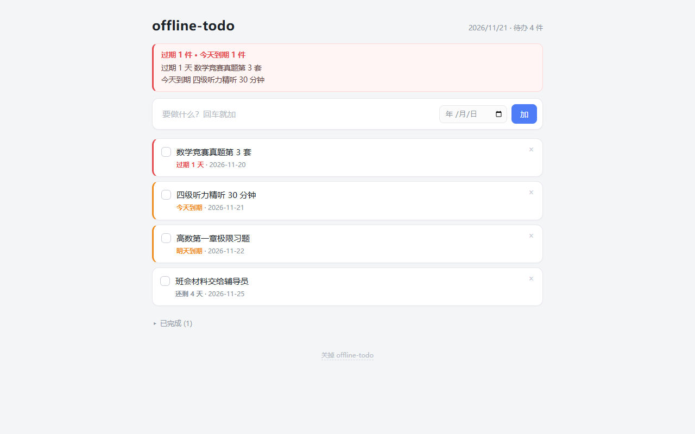

# offline-todo

> 一个只在你电脑上跑的待办清单。没有账号，不联网，数据就是硬盘上一个 JSON 文件。
> A local-only todo list. No account, no cloud, no telemetry — just a JSON file on your disk.



## 为什么又写一个待办

因为现成的那些，要么要注册、要么要开会员、要么在我没网的时候打不开。
这个只有一件事要做到：**我随手记下的事情，不会忘。**

所以它刻意做得小：

- **零依赖。** 只用 Python 标准库，`pip install` 一行都不用跑，也没有供应链风险。
- **零联网。** 服务只监听 `127.0.0.1`，除你之外的任何设备都连不进来。
- **零数据库。** 数据是 `data/todos.json`，纯文本，能看、能改、能复制走。
- **会过期就变红。** 过期标红、两天内标橙，顶部还有提醒条——先看最急的那几件。

## 快速开始

需要一个 Python 3.8 以上版本（[官网下载](https://www.python.org/downloads/)，Windows 安装时记得勾 *Add python.exe to PATH*）。

**Windows**

双击 `start.bat`

**macOS / Linux**

```bash
chmod +x start.sh
./start.sh
```

**或者随手一行**

```bash
python app.py               # 默认从 8765 端口开始找空位
python app.py --port 9000   # 指定端口
python app.py --no-browser  # 不自动开浏览器
```

启动后浏览器会自动打到界面。终端窗口就是程序本体，关掉它就退出；页面底部也有「关掉」。

## 怎么用

| 操作 | 怎么做 |
|---|---|
| 加一条 | 输入框里打字，回车 |
| 定截止日 | 用右边的日期框（可以不填，不填就排到最后） |
| 做完了 | 点左边的小方框，再点一次撤销 |
| 改内容/改日期 | **双击标题** |
| 删掉 | 点右边的 × |

排序规则很简单：有截止日的按日期从近到远，没日期的沉底。

## 数据在哪

```
data/todos.json
```

- **备份** = 把这个文件复制走
- **换电脑** = 把这个文件拷过去
- **清空** = 删掉它（下次启动会重新建）
- `data/` 已经在 `.gitignore` 里，你的待办不会被 git 带上提交

## 目录结构

```
offline-todo/
├── app.py              # 后端：读写 JSON、HTTP 接口、启动时弹提醒
├── ui.html             # 前端：整个界面就这一个文件，没有构建步骤
├── start.bat           # Windows 双击入口
├── start.sh            # macOS / Linux 入口
├── screenshots/
│   └── main.png
├── data/todos.json     # 你的数据（不提交）
├── LICENSE
└── README.md
```

只有两个核心文件。**改界面不需要懂 Python，改 `ui.html` 就行，刷新页面立刻看到效果** —— 颜色在顶部的 `:root` 变量里，排序在 `load()` 里。

## 接口

界面就是靠这几个接口干活的，你想接别的客户端也能直接用：

| 方法 | 路径 | 说明 |
|---|---|---|
| GET | `/api/list` | 取全部条目 + 今天的日期 |
| POST | `/api/add` | `{title, due}` |
| POST | `/api/toggle` | `{id}` 完成/撤销 |
| POST | `/api/edit` | `{id, title, due}` |
| POST | `/api/delete` | `{id}` |
| POST | `/quit` | 关掉程序 |

## 已知限制

- **只有启动时才会提醒。** 没开就没有提醒——这是我目前最不满意的一点（见 Roadmap）。
- 单机单用户，没有多端同步，这是设计取舍不是 bug。
- 没有重复任务（「每周三交作业」得手动加）。
- 没有优先级，只有日期。

## Roadmap

- [x] v1：增删改查、倒计时、过期标色、启动提醒
- [ ] 常驻托盘 / 系统定时提醒，不启动也能催
- [ ] 重复任务
- [ ] 优先级与标签
- [ ] 导入导出（.ics / Markdown）

## License

[MIT](LICENSE)
